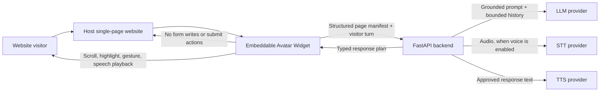
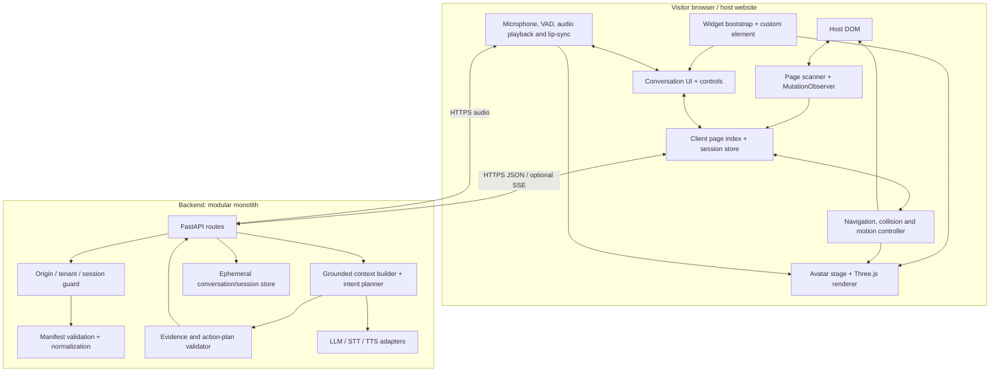
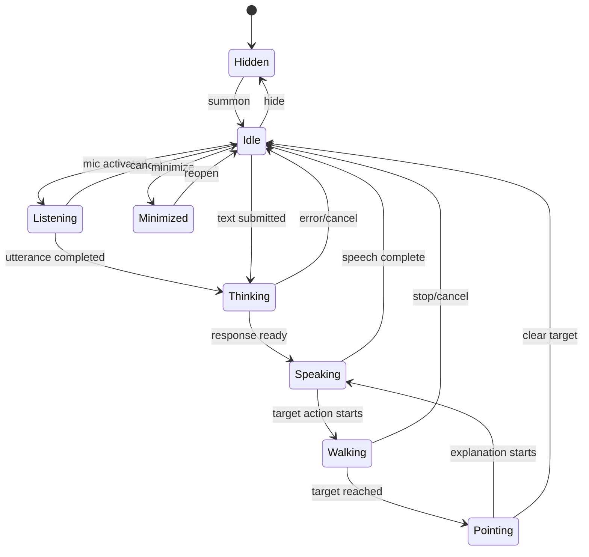
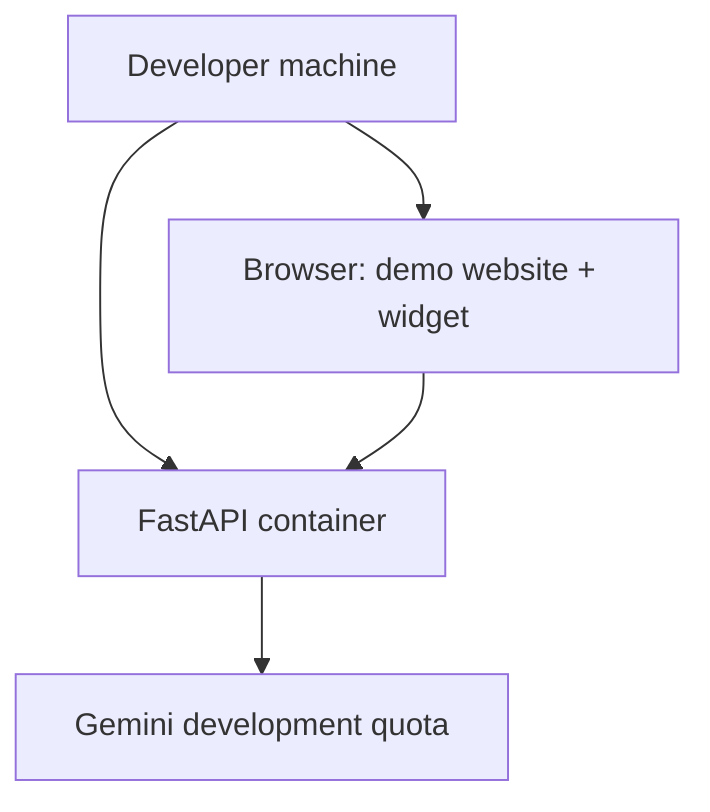

# AI Avatar Website Assistant
## High-Level Design (HLD)

| Field | Value |
|---|---|
| Document status | Proposed architecture, implementation-ready baseline |
| Version | 1.0 |
| Last reviewed | 1 November 2026 |
| Product | Embeddable full-body AI website guide |
| Primary deliverable | A reusable widget plus a demonstrator single-page website |

---

## 1. Executive summary

Build an embeddable **website guide** that combines a full-body 3D avatar, voice/text conversation, a live semantic map of the host page, and a tightly controlled navigation/pointing system.

The recommended architecture is a **TypeScript widget + Three.js/VRM renderer + Python/FastAPI modular backend**. The browser observes the host page and sends a privacy-filtered, structured page manifest to the backend. The backend uses an LLM to interpret the visitor's request against that manifest and returns a validated, typed action plan. The browser, not the LLM, resolves target IDs to DOM elements, scrolls, repositions the avatar, highlights the target, and runs the matching animation.

The LLM is therefore a *planner*, not an actuator. It cannot emit JavaScript, CSS selectors, arbitrary URLs, DOM mutations, form values, clicks, or submission commands.

### Recommended baseline

- **Frontend/widget:** TypeScript, React for the demo shell, framework-neutral custom element for embedding, Three.js, `@pixiv/three-vrm`, Web Audio API.
- **Backend:** Python 3.12+, FastAPI, Pydantic, provider adapters, in-memory session state for the first release.
- **Page understanding:** DOM/accessibility metadata extraction, local lexical/semantic ranking, page-revision tracking; no vector database in the MVP.
- **Conversation:** Gemini Flash-family model behind a provider interface; free tier for development only, paid tier for production. Keep OpenAI and other providers pluggable.
- **Speech:** browser speech synthesis and an opt-in browser recognition path for a zero-cost demo; configurable STT/TTS provider adapters for reliable production voice.
- **Avatar:** licensed VRM full-body model, pre-authored animation clips plus procedural gesture/lip motion.
- **Deployment:** local Docker Compose for development; static widget/demo hosting plus a separately deployed FastAPI service for production.

This design meets the assignment requirements without prematurely introducing microservices, a vector database, Kafka, or a costly avatar-video platform.

---

## 2. Problem framing and scope

### 2.1 User-facing capabilities

1. Display a full-body avatar in a compact, non-blocking overlay.
2. Let visitors minimize, hide, reopen, and interact by text or voice.
3. Keep the avatar animated while idle, listening, thinking, speaking, walking, and pointing.
4. Answer questions using only information observed on the current page.
5. Find headings, sections, links, buttons, and form fields, including after SPA content changes.
6. Scroll to the relevant element, move the avatar beside it, highlight it, point, and explain it.
7. Run an ordered page tour.
8. Guide visitors through forms while observing completion and validation state.
9. Never type into fields or submit forms without explicit visitor permission. The MVP will be stricter: **the avatar never writes field values or submits forms at all**.

### 2.2 In scope

- One host page per active widget session, including an SPA route change as a new page revision.
- Public, rendered DOM content and accessible metadata.
- Same-origin links and visible controls.
- Conversational session context with a bounded history.
- English-first demo, with language and voice configurable.
- A demo page containing hero, company description, features, pricing, signup/contact form, and intentionally unanswered questions.

### 2.3 Out of scope for the first release

- Navigating across arbitrary cross-origin iframes.
- Scraping authenticated backend data not rendered in the page.
- Filling or submitting forms, making purchases, accepting legal terms, or taking other consequential actions.
- Autonomous browsing, general web search, or answering facts not present on the page.
- Custom avatar generation, real-time video avatars, or multi-agent orchestration.
- Long-term user memory across visits. Only short-lived session context is retained.

### 2.4 Assumptions

- The host site allows the widget script and its API origin through its CSP and network policies.
- The host page runs in a modern browser with WebGL support for the best experience.
- The integrator can provide a tenant key/public widget identifier and allowlisted host origin.
- A properly licensed VRM asset and its associated animation/voice assets are supplied before release.

---

## 3. Architecture principles

| Principle | Design consequence |
|---|---|
| Deterministic actions | LLMs produce typed plans. Browser code executes only allowlisted actions. |
| Page-grounded answers | Every factual response carries page-node evidence; unsupported requests get an explicit fallback. |
| Least privilege | Widget reads public page structure, not input values, cookies, local storage, or arbitrary app state. |
| No silent form actions | No automatic typing, clicking, submission, or consent acceptance. |
| Progressive enhancement | Text mode remains available if microphone, speech, WebGL, or a provider is unavailable. |
| Small operational footprint | Modular monolith first; add infrastructure only after measured need. |
| Vendor portability | LLM, STT, and TTS are interfaces selected by server-side configuration. |
| Embed isolation | Custom element + Shadow DOM isolates the widget's styles from the host website. |
| Privacy by default | Do not retain raw audio or typed form data; use ephemeral sessions. |

---

## 4. System context and architecture

### 4.1 Context diagram



### 4.2 Container/component diagram



### 4.3 Responsibility boundaries

**Widget (untrusted host-page environment):** extracts a small, safe representation of the rendered page; captures visitor input only after interaction; applies validated navigation instructions; renders UI and avatar motion. It does not hold provider secrets.

**Backend (trusted application boundary):** authenticates the embed/session, validates and compacts the page manifest, maintains bounded conversation context, calls provider APIs, validates model output, applies rate limits, and returns a typed response.

**LLM provider:** interprets intent and drafts short copy using supplied page evidence. It has no browser tools and no direct host-page access.

**Speech providers:** transcribe visitor audio and synthesize only the final, validated assistant response. Voice is optional and replaceable.

---

## 5. Primary runtime flows

### 5.1 Initial page discovery

1. The embed bootstrap mounts a custom element with a Shadow DOM root.
2. The scanner reads visible headings, landmarks/sections, paragraphs, links, buttons, and form-control metadata.
3. Each eligible element receives a stable, widget-scoped `data-avatar-node-id` for the life of that DOM node. IDs are not CSS selectors.
4. The scanner strips hidden content, scripts, styles, event handlers, input values, password fields, and unnecessary attributes.
5. A compact manifest is sent to the backend with a monotonically increasing revision and content hash.
6. The backend validates sizes, normalizes text, and caches the latest manifest for the session.

### 5.2 Ask a question

1. Visitor submits text or finishes a voice utterance.
2. Voice input is transcribed if required. A microphone permission prompt and visible recording state are mandatory.
3. The backend retrieves the current page manifest and a bounded recent conversation window.
4. Candidate nodes are ranked using deterministic term/label matching and, if useful, an LLM selection step. For the small single-page demo, this avoids vector-database overhead.
5. The LLM returns a structured plan with a short response, intent, target node IDs, section order, gesture, and evidence node IDs.
6. Pydantic validation and a second evidence/allowlist check reject malformed, unsupported, or unsafe plans.
7. The browser receives the response and plan. It speaks the answer if voice is enabled and runs the prescribed visual action.
8. The visitor can interrupt speech, stop a tour, or ask a follow-up at any time.

### 5.3 Navigate and point

1. Resolve the target ID against the current DOM map. If stale, request a manifest refresh and re-plan once.
2. Scroll the target into a useful viewport position with smooth scrolling.
3. Recalculate the target's bounding rectangle after scrolling and layout settling.
4. Choose an avatar anchor near the target that avoids the target itself, fixed controls, and viewport edges.
5. Move the avatar stage using an eased trajectory while playing a walk animation.
6. Highlight the target with a temporary outline/backplate and draw a subtle pointer/connector if needed.
7. Play the pointing gesture whose direction is calculated from avatar to target.
8. Speak one or two concise sentences. Clear highlight after a timeout or on the next action.

### 5.4 Guided tour

- Build the tour from visible page sections in document order, prioritizing semantic landmarks and headings.
- Exclude navigation chrome, hidden sections, and duplicate nested headings.
- Present one section at a time. A visitor can pause, skip, stop, ask a question, or minimize the widget.
- Re-resolve each target before moving. If the page changes, reconcile the remaining tour with the latest revision.

### 5.5 Form guidance

- Detect labels, required state, input type, help text, and validation flags without reading the input's value.
- Explain one field at a time and point at it.
- Monitor `input`, `change`, `invalid`, and relevant DOM mutations. Report only a coarse state: `empty`, `filled`, `invalid`, or `unknown`.
- Values, passwords, textareas' contents, and selected option values are never added to the page manifest or conversation history.
- The visitor enters all information manually. The widget does not click submit.

---

## 6. Page understanding strategy

### 6.1 Structured DOM manifest first

The page is a single-page surface. Its live rendered DOM is the source of truth, so the MVP should not crawl the public web or build a vector index by default.

The manifest contains:

- Page title, canonical/current URL (origin and path only where possible), and revision.
- Semantic section/landmark tree, headings, concise visible text snippets.
- Interactive nodes: accessible name, role, tag, relevant type, disabled/required flags, same-origin destination where applicable.
- Form field metadata: associated label, type, required, help text, and validation status only.
- Stable node IDs and coarse layout metadata for local target resolution.

### 6.2 Incremental update strategy

- Use `MutationObserver` to watch child, text, and selected attribute changes outside the widget subtree.
- Debounce manifest recomputation (initial default: 300 ms) and hash normalized node records.
- Send only changed nodes plus a revision, or send a full compact manifest if delta complexity is not justified by measurement.
- Use `ResizeObserver` and scroll/resize events for local geometry refresh. Do not send geometry on every scroll.
- Detect SPA route changes with a lightweight location/history hook and page title change observation.
- Rebuild a full manifest after navigation, a large mutation burst, or a stale target error.

### 6.3 Ranking and retrieval

**MVP:** exact accessible-name/heading matching, normalized token matching, section proximity, role/type boosts, and a small provider model call for ambiguous phrasing.

**Scale option:** add embeddings and Postgres `pgvector` only if page size, number of pages, or measured recall justifies it. Keep the original page-node IDs as the canonical references; vector hits are candidate IDs, not execution authority.

### 6.4 Grounding contract

Every factual answer must be supported by one or more manifest node IDs. If evidence is missing or confidence is below the configured threshold, respond with a clear statement such as: “I can’t find that information on this page.” Do not use general model knowledge to fill the gap.

---

## 7. AI and speech provider strategy

Provider choice is made on the server. Keys are never shipped in the widget bundle. The application should expose provider configuration by environment variables and tenant policy, not hard-coded vendor-specific logic.

### 7.1 Recommended cost tiers

| Capability | Free / development path | Paid / production path | Recommendation |
|---|---|---|---|
| Text reasoning | Gemini API free tier for low-volume development and prompt evaluation | Gemini paid tier or an OpenAI model selected by benchmark | Start with Gemini Flash-family. Keep model name configurable. Use a paid tier for production privacy, rate limits, and predictable operations. |
| Speech-to-text | Browser `SpeechRecognition` where supported, or self-hosted Whisper/faster-whisper at the cost of compute | Groq Whisper API or another managed STT provider | Do not make browser recognition the only production path. It has uneven support and may use a remote browser-vendor service. |
| Text-to-speech | Browser `SpeechSynthesis` for demos; self-hosted TTS where operations justify it | ElevenLabs API or a supported paid realtime voice API | Use browser TTS to prove the flow. Select a paid voice only after testing pronunciation, latency, language, commercial rights, and per-session cost. |
| Full duplex voice | Not required for MVP | Gemini Live API or OpenAI Realtime API, subject to current model/account availability | A later upgrade, not an MVP dependency. Turn-based STT → LLM → TTS is easier to debug and keeps action planning separate. |
| Avatar animation | Three.js + licensed VRM asset + local animation clips | Same; optional paid character/model production | Keep the renderer under our control. Video-avatar SaaS is a poor fit for deterministic walking, pointing, and DOM targeting. |

### 7.2 Important provider constraints (checked 1 November 2026)

- Google documents a Gemini API free tier and paid tier. Its current pricing page states that free-tier content may be used to improve products, while paid-tier content is not; do not send personal form values or secrets, and use a paid tier with the appropriate contractual/privacy review for production traffic. Free-tier quotas and model access can change. [Gemini API pricing](https://ai.google.dev/gemini-api/docs/pricing)
- Groq documents OpenAI-compatible transcription endpoints and lists `whisper-large-v3-turbo` at approximately **$0.04 per audio hour** on the current speech-to-text page. Treat prices and account quotas as mutable configuration, not constants. [Groq speech-to-text](https://console.groq.com/docs/speech-to-text)
- ElevenLabs currently lists a $0 Free plan with 10,000 shared monthly credits and paid plans with commercial-license features. Confirm API availability, credit consumption, voice rights, and the exact plan terms before commercial use. [ElevenLabs pricing](https://elevenlabs.io/pricing)
- OpenAI's current docs announce that the legacy Speech API models including `gpt-4o-mini-tts` are scheduled to shut down on **6 January 2027** and direct new integrations toward its Realtime API. Do not build a new production dependency on the deprecated Speech API model IDs. [OpenAI text-to-speech guide](https://developers.openai.com/api/docs/guides/text-to-speech)
- Browser `SpeechRecognition` is not Baseline across major browsers; some implementations send audio to a remote recognition service and do not work offline. [MDN SpeechRecognition](https://developer.mozilla.org/en-US/docs/Web/API/SpeechRecognition)
- Gemini Live API maintains a persistent audio context and its documentation explains that prior context is billed again on each turn. Bound session duration and context, or use the simpler turn-based pipeline until realtime interaction provides measured value. [Gemini Live API best practices](https://ai.google.dev/gemini-api/docs/live-api/best-practices)

### 7.3 Recommended initial configuration

```text
LLM_PROVIDER=gemini
LLM_MODEL=<current-supported-flash-model-id>
STT_PROVIDER=browser_or_groq
STT_MODEL=whisper-large-v3-turbo
TTS_PROVIDER=browser
TTS_VOICE=<browser-default-or-configured-voice>
VOICE_MODE=turn_based
```

Production candidate:

```text
LLM_PROVIDER=gemini_paid
LLM_MODEL=<benchmarked-production-model-id>
STT_PROVIDER=groq
STT_MODEL=whisper-large-v3-turbo
TTS_PROVIDER=elevenlabs
TTS_MODEL=<currently-supported-low-latency-model-id>
VOICE_MODE=turn_based
```

The placeholders are intentional. Pin exact model IDs only after a smoke test in the chosen account and region; provider catalogs, quotas, pricing, and deprecation schedules change.

### 7.4 Why not use one realtime voice API for everything immediately?

A realtime speech-to-speech API can improve conversational flow, but this product also requires grounded page evidence, structured actions, predictable tool boundaries, interruption control, and low-cost fallback behavior. A modular pipeline makes it easier to inspect transcripts, enforce page-only answers, and reject unsafe action plans. Add full duplex only after measuring turn latency and user experience.

---

## 8. Avatar rendering and movement

### 8.1 Rendering stack

- `Three.js` for scene, camera, lights, renderer, and animation loop.
- glTF/VRM asset loaded through `GLTFLoader` and `@pixiv/three-vrm`.
- VRM expression channels for mouth shape and facial expression where the supplied avatar supports them.
- Pre-authored full-body animation clips for idle, walk, point-left, point-right, and explain/open-palm.
- Procedural blend between idle and speech/gesture layers to prevent a frozen character.

References: [Three.js GLTFLoader](https://threejs.org/docs/pages/GLTFLoader.html), [@pixiv/three-vrm documentation](https://pixiv.github.io/three-vrm/docs/).

### 8.2 Avatar state model



Animation layers should be independently blendable: base idle/locomotion, upper-body gesture, face expression, and mouth movement. A priority controller prevents conflicting clips. For example, locomotion owns the legs while the pointing clip owns the upper body.

### 8.3 Lip synchronization

- Preferred: use provider word/phoneme alignment where available and map phonemes to VRM mouth shapes (`aa`, `ih`, `ou`, `ee`, `oh`).
- Baseline: analyze the currently playing audio with Web Audio `AnalyserNode` and drive a smoothed mouth-open value. This is approximate amplitude lip-sync, not phoneme-accurate.
- If only browser `SpeechSynthesis` is used, use a subtle procedural mouth loop synchronized to utterance events; do not claim exact phoneme sync.

### 8.4 Movement and non-obstruction

The avatar is a floating stage positioned at a safe viewport anchor, not a DOM child of the target. On navigation, calculate a new anchor adjacent to the target and animate the stage across the viewport with an eased trajectory. The character walk clip plays during translation. The target is never covered by the avatar; a connector/pointing line bridges the visual gap when the avatar cannot safely stand very close.

- Desktop default: compact stage on a viewport edge, relocate to the side of the target with more free space.
- Mobile: smaller full-body stage and collapsible control strip; prefer a safe lower/upper corner and a connector line rather than covering the form control.
- Clamp stage bounds to safe viewport insets; account for fixed headers, sticky footers, browser zoom, and visual viewport resize.
- Respect `prefers-reduced-motion`; replace travel animation with a short fade/position change.
- When WebGL is unavailable, offer text navigation/highlighting and an accessible static avatar fallback. Do not block the page.

---

## 9. Embedding model

### 9.1 Integration target

Expose a framework-neutral custom element / bootstrap API. React is used for the demo page and internal UI composition, not required of host sites.

Example host integration:

```html
<script
  src="https://cdn.example.com/site-guide/v1/widget.js"
  data-widget-id="public-widget-id"
  defer
></script>
```

Optional explicit configuration:

```html
<script type="module">
  import { SiteGuide } from "https://cdn.example.com/site-guide/v1/site-guide.js";

  SiteGuide.init({
    widgetId: "public-widget-id",
    apiBaseUrl: "https://api.example.com",
    position: "bottom-right",
    locale: "en-IN",
    voiceEnabled: true
  });
</script>
```

No secret API key is accepted in browser configuration. The public widget ID identifies an integration, not an authorization secret.

### 9.2 Isolation and host compatibility

- Mount all UI under a custom element with Shadow DOM and CSS reset scoped to the shadow root.
- Use one fixed, high-but-configurable stacking context. Avoid global CSS selectors and global event interception.
- Keep the canvas non-interactive; only explicit widget controls receive pointer events.
- Never prevent normal host-page form submission or navigation. The widget itself does not submit forms.
- Provide `destroy()` to remove listeners, observers, audio tracks, timers, animation loops, and DOM nodes.
- Document CSP directives, allowed API host, asset host, and CORS origin registration.

---

## 10. Backend and data architecture

### 10.1 Modular monolith

One FastAPI deployment with clearly separated packages:

- `api`: HTTP routes and streaming responses.
- `auth`: tenant, origin, and session validation.
- `page`: manifest schemas, sanitizer, revision store, candidate ranking.
- `conversation`: bounded memory and turn orchestration.
- `planner`: prompt construction, structured output, evidence validator, action allowlist.
- `providers`: LLM, STT, and TTS adapters.
- `observability`: structured logs, metrics, traces, and redaction.

### 10.2 Persistence

**MVP:** ephemeral session store with TTL (in-process for a single demo instance; Redis only when multiple backend replicas need shared sessions). No persistent chat history or raw audio storage.

**Production:** Postgres for tenant configuration, host allowlists, feature flags, and operational metadata. Redis for session state, rate limiting, and short-lived manifests when horizontal scaling requires it. Add `pgvector` only for a demonstrated retrieval need.

### 10.3 Logical data entities

| Entity | Purpose | Retention |
|---|---|---|
| TenantConfig | Widget ID, allowed origins, provider policy, locale, rate limits | Persistent |
| VisitorSession | Session ID, tenant, page revision, bounded turns, expiry | Short TTL |
| PageManifest | Normalized current-page nodes and revision | Session TTL; replace on update |
| PageNode | Stable node ID, role, label, safe text, section, flags, same-origin href | Replaced with manifest |
| Turn | Visitor transcript/text, assistant text, selected evidence IDs, status | In-memory/short TTL by default |
| ActionPlan | Validated intent, target IDs, tour steps, gesture | Turn lifetime |

No form input values are entities in the system.

---

## 11. Security, privacy, and safety

### 11.1 Trust boundaries

- Host DOM content is untrusted data. It may contain adversarial instructions or prompt injection.
- User utterances are untrusted input.
- LLM output is untrusted until schema, evidence, target, and intent validation pass.
- The widget is embedded in a page controlled by another party; assume DOM churn and CSS collisions.
- Provider credentials and tenant secrets stay server-side.

### 11.2 Required controls

1. **Prompt-injection resistance:** page text is quoted/typed as evidence, never treated as system instructions. System policy is fixed server-side.
2. **Action allowlist:** only `answer`, `navigate_to_node`, `start_tour`, `guide_form_field`, `stop`, and `unknown` are accepted. No `execute_js`, `click`, `submit`, `fill`, or arbitrary URL action exists.
3. **Evidence enforcement:** target/evidence IDs must exist in the current manifest. Each factual answer must cite one or more evidence nodes internally.
4. **Origin controls:** validate tenant origin against a configured allowlist; configure CORS narrowly. Origin validation supplements, not replaces, session authentication and abuse protection.
5. **Rate limits and quotas:** per tenant, session, IP bucket, and provider; cap audio size, duration, request tokens, turn count, and tour length.
6. **Secret management:** API keys in a server-side secret manager/environment, rotated and scoped.
7. **Data minimization:** never transmit form values, password values, cookies, local storage, or arbitrary page scripts. Redact audio/transcript logs by default.
8. **Microphone consent:** request browser permission only after visitor presses the mic button; show recording indicator; stop tracks after turn/cancel.
9. **Retention:** no raw audio by default; session state expires automatically; provide tenant-configurable deletion and retention policies.
10. **Safe URLs:** only same-origin, normalized `http(s)` destinations may be surfaced; no `javascript:`, `data:`, or unknown schemes.
11. **Output validation:** strict JSON schema, bounded strings and arrays, no HTML rendering without escaping.
12. **Human control:** no silent field entry or submission, and a visible stop/close control at all times.

### 11.3 Privacy posture

The assistant should tell visitors that voice is processed by the configured speech/AI providers. For a production deployment, publish a privacy notice and obtain any required consent before recording or transmitting voice. The free Gemini tier's data-use terms make it appropriate for synthetic development data, not a default for private production conversations.

---

## 12. Non-functional requirements and proposed targets

These are engineering targets to validate, not guarantees.

| Area | Initial target | How to measure |
|---|---|---|
| Widget startup | UI shell visible under 1 s on a typical broadband desktop; 3D model lazy-loaded after summon | RUM marks |
| Page scan | Initial manifest under 500 ms for a typical marketing page | Browser performance marks |
| Incremental updates | Manifest stable within 1 s of common SPA content changes | Mutation-to-sync timing |
| Text turn latency | p50 under 2.5 s, p95 under 6 s after submit | Backend + client spans |
| Voice turn latency | p50 under 4 s, p95 under 8 s after end-of-utterance for baseline modular pipeline | Audio timestamps |
| Navigation | Target found and highlighted in 95%+ of supported demo scenarios | Instrumented scenario suite |
| Target accuracy | At least 95% correct node resolution on curated evaluation pages | Ground-truth target test set |
| Grounding | 100% of factual answers carry valid evidence IDs; unsupported test questions abstain | Automated validator tests |
| Privacy | Zero field values or passwords in page manifests/logs | Redaction/security tests |
| Form safety | Zero autonomous field writes or submissions | Browser tests / action allowlist |
| Resilience | Text mode works if voice/3D/provider feature fails | Fault-injection tests |
| Accessibility | Keyboard-operable controls, captions/text transcript, reduced-motion support | axe/manual review |

### Performance guardrails

- Lazy-load the 3D model, animation clips, and speech code only when needed.
- Compress glTF textures/geometry; use KTX2/Draco/meshopt only when the asset pipeline supports them.
- Cap renderer pixel ratio (for example, 1.5) and pause the render loop when hidden/minimized or the tab is backgrounded.
- Keep DOM extraction bounded by max nodes, max text per node, and total manifest bytes.
- Bound history and prompt tokens. Cache the page manifest by revision and avoid re-sending unchanged page context.

---

## 13. Failure handling and graceful degradation

| Failure | User-visible behavior | System response |
|---|---|---|
| Microphone denied/unavailable | Keep text input and display a brief explanation | No repeated permission prompts |
| Speech recognition unsupported | Offer text mode or configured STT upload path | Do not assume `SpeechRecognition` exists |
| TTS provider unavailable | Show the same answer as text; optionally use browser speech synthesis | Provider timeout + circuit breaker |
| LLM timeout/over quota | Explain temporary unavailability and preserve typed input | Bounded retry with jitter; no unbounded retries |
| Stale target node | Refresh page manifest and retry planning once | If still missing, ask a clarifying question or show the section list |
| Host page mutates during tour | Pause, refresh, reconcile remaining steps | Never act on stale element references |
| WebGL/context loss | Hide the canvas and retain the text/navigation guide | Reinitialize once; fallback on repeated failure |
| Target covered by sticky UI | Use alternate anchor/connector and safe scroll offset | Geometry-based collision check |
| Hidden/disabled control | Explain that the control is unavailable | Never force-enable or click it |
| Unknown question | State that the page does not say | Do not answer from model priors |

---

## 14. Deployment topology

### Development / assessment demo



- Use Docker Compose for the API and optional Redis/Postgres.
- Keep local provider keys in `.env` (gitignored).
- Use browser TTS and browser speech recognition where available for a zero-cost path; test text mode as the guaranteed fallback.
- Provide a deterministic mock-provider mode so the demo remains runnable without external AI credentials.

### Production

- Static frontend/widget bundle and versioned assets delivered through a CDN.
- FastAPI service behind HTTPS load balancer/API gateway.
- Postgres for tenant settings and operational metadata.
- Redis for shared short-lived sessions and rate limits when multiple replicas are used.
- Secret manager for provider credentials.
- Centralized metrics, tracing, redacted logs, provider spend dashboards, and alerts.

Do not introduce Kubernetes or a message broker solely for this assignment. A small container service is enough until traffic or reliability requirements justify more.

---

## 15. Key architecture decisions (ADRs)

### ADR-001: Modular monolith instead of microservices

**Decision:** one FastAPI application with internal modules.

**Reason:** the product has one synchronous request/response workflow, one page per session, and no independent high-throughput subsystem. A modular monolith reduces deployment and debugging overhead while preserving future extraction boundaries.

### ADR-002: DOM manifest instead of crawling/vector DB by default

**Decision:** observe the rendered DOM and create a structured manifest.

**Reason:** the assignment is specifically about the current single-page website. Current DOM and accessible metadata are more accurate than a separately crawled or stale index. Add embeddings only when measurement demonstrates a need.

### ADR-003: LLM plans, browser executes

**Decision:** the LLM returns typed node references and intentions; deterministic client code performs safe navigation and animation.

**Reason:** prevents arbitrary code execution, makes action tests deterministic, and keeps the LLM away from the host page's execution context.

### ADR-004: VRM + Three.js instead of generated talking-head video

**Decision:** render a licensed full-body VRM model in a controlled 3D stage.

**Reason:** the avatar must walk, orient, gesture, and point at arbitrary DOM targets. A rendered video/avatar service is less controllable for spatial interactions and can add recurring cost and latency.

### ADR-005: Turn-based voice first; realtime voice later

**Decision:** separate STT, reasoning, and TTS in v1.

**Reason:** simpler observability, grounding enforcement, fallback, and cost control. Realtime audio is an enhancement after latency measurement.

### ADR-006: No form writes in MVP

**Decision:** avatar explains and observes only; visitor types and submits.

**Reason:** directly satisfies the assignment's consent boundary while removing risks around sensitive information and unintended submissions.

---

## 16. Delivery plan

| Phase | Output | Exit condition |
|---|---|---|
| 1. Skeleton | Demo page, custom-element bootstrap, floating controls, text chat | Widget embeds on a separate test page without CSS breakage |
| 2. Page map | Scanner, manifest, mutation updates, target IDs | Correctly discovers sections, CTAs, and form fields after DOM changes |
| 3. Grounded AI | Provider adapters, page-only prompt, schema/evidence validator | Answers supported questions and abstains on unsupported ones |
| 4. Navigation | Scroll, target highlight, avatar relocation, gestures, tour | “Where can I sign up?” resolves the real CTA and points to it |
| 5. Full-body motion | VRM model, idle/walk/point clips, lip motion | Full-body avatar remains animated while listening/speaking and moves smoothly |
| 6. Voice + forms | STT/TTS adapters, field-state watcher, guided form flow | Voice demo works; all form actions remain visitor-controlled |
| 7. Hardening | security, accessibility, performance, demo recording | Test matrix passes; 2-3 minute recording demonstrates required scenarios |

---

## 17. Acceptance checklist mapped to the assignment

| Assignment requirement | Architectural mechanism |
|---|---|
| Full-body character | Licensed VRM model rendered with Three.js |
| Minimize, hide, summon | Widget shell state and persistent reopen control |
| Does not block content | Geometry-aware anchor placement, collision checks, compact/mobile layout |
| Voice or text | Text input plus optional STT/TTS adapters |
| Natural short replies | Response length policy and concise prompt |
| Lip sync and body language | VRM expression driver plus layered animation controller |
| Follow-up memory | Bounded session turn history |
| Understands sections and controls | DOM/accessibility manifest |
| Page-only knowledge | Evidence-constrained planner and verifier |
| Updates when page changes | MutationObserver + revision/hash sync |
| Scrolls and points | Deterministic navigation controller and target highlight |
| Smooth movement | Eased stage translation plus walk animation |
| Guided tour | Ordered semantic section plan |
| Form guidance | Field metadata and coarse validity state observer |
| No silent form submission | No submit/click/fill action in the API schema or browser executor |
| Unknown answer handled | Evidence failure → explicit abstention |
| Embeddable on another SPA | Versioned custom element/bootstrap API and Shadow DOM |

---

## 18. References

Provider offerings, plan limits, model catalogs, prices, and browser support change. Re-check before implementation and again before production launch. Accessed 1 November 2026.

1. [Google Gemini API pricing and free/paid data-use terms](https://ai.google.dev/gemini-api/docs/pricing)
2. [Groq speech-to-text models, endpoints, and pricing](https://console.groq.com/docs/speech-to-text)
3. [ElevenLabs plans, credits, and commercial-use features](https://elevenlabs.io/pricing)
4. [OpenAI text-to-speech guide and migration/deprecation notice](https://developers.openai.com/api/docs/guides/text-to-speech)
5. [Gemini Live API best practices and context billing behavior](https://ai.google.dev/gemini-api/docs/live-api/best-practices)
6. [MDN: SpeechRecognition compatibility and behavior](https://developer.mozilla.org/en-US/docs/Web/API/SpeechRecognition)
7. [Three.js GLTFLoader](https://threejs.org/docs/pages/GLTFLoader.html)
8. [@pixiv/three-vrm documentation](https://pixiv.github.io/three-vrm/docs/)
9. [Vercel Hobby plan, suitable for personal/demo hosting subject to current terms](https://vercel.com/docs/plans/hobby)
